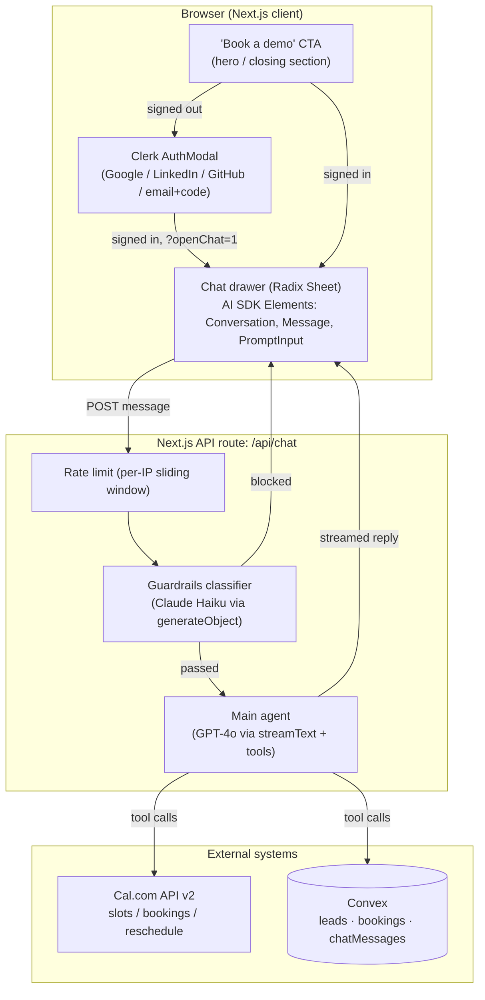
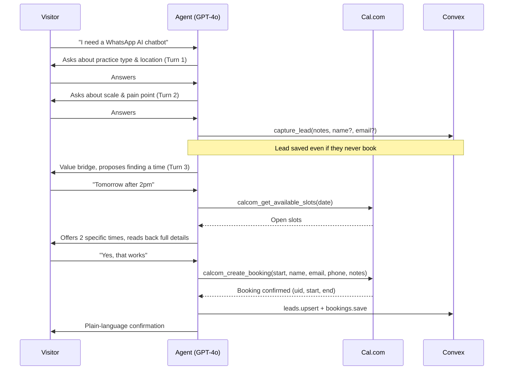

# Sting Runner AI — sales & booking agent architecture

Reference document for the AI-driven "book a demo" agent on sting.delivery. Written to be pasted into an LLM to generate a diagram, slide, or talking points — not for the codebase itself.

---

## What this demo does NOT cover

Be upfront about these if asked — don't stretch the story to fit:

- **No AWS / cloud infra work.** Runs on Vercel (Next.js) + Convex, not Lambda/S3/IAM/EC2.
- **No Terraform / IaC.** Nothing here provisions infrastructure declaratively.
- **No Python.** TypeScript/Node.js end to end.
- **No LangGraph or a dedicated agent-orchestration framework.** Uses the Vercel AI SDK's native tool-calling (`streamText` + `tool()` + `stopWhen`) — conceptually the same multi-step tool-loop pattern, different library.
- **No custom MCP server.** Tools are plain AI SDK tool definitions, not exposed over the Model Context Protocol.
- **No dedicated AI observability platform** (LangSmith, Phoenix, Helicone). Has hand-rolled token/model logging instead (see Observability below) — real, but not a mature tracing product.
- **No advanced SQL / data warehousing.** Convex is a reactive document database, not a SQL data warehouse.
- **No serverless ETL pipelines.**
- **No per-customer dedicated infrastructure.** Multi-tenant on shared infra with logical isolation (every row is scoped to a Clerk-derived user ID), not separate AWS accounts per customer.

---

## System overview

A Next.js marketing site with an embedded AI sales concierge. A visitor clicks "Book a demo," authenticates, and has a qualifying conversation with an LLM-driven agent that can check real calendar availability, book a call, reschedule it, and persist a CRM lead — all through tool calls against live external systems (Cal.com, Convex), not canned responses.

---

## The booking conversation flow

Confirm-before-commit is enforced at three layers: the conversation framework, the tool description text, and a worked example in the system prompt — so no booking or reschedule fires without an explicit "yes."

---

## Agent tools

| Tool | Purpose | Notes |
|---|---|---|
| `capture_lead` | Save/update the CRM lead record | Fires independent of booking — this is what prevents losing a conversation that never converts |
| `calcom_get_available_slots` | Query real Cal.com availability for a date | Timezone-aware, uses the visitor's browser-detected timezone |
| `calcom_create_booking` | Confirm a booking in Cal.com + persist it | Requests Google Meet as location, falls back to the event type's default if rejected |
| `calcom_reschedule_booking` | Move an existing booking to a new time | Cal.com issues a new booking UID on reschedule; the Convex row is patched in place, not duplicated |

Every tool has a Zod input schema (`ai`'s `tool()` + `inputSchema`), so malformed model output is rejected before it reaches any external API.

---

## Lead capture reliability (defense in depth)

Two independent layers guarantee no engaged visitor is lost, rather than trusting the LLM alone:

1. **Deterministic baseline** — the moment a signed-in visitor sends their first real message, a Convex upsert fires using their Clerk identity (name/email), with zero LLM involvement.
2. **LLM enrichment** — `capture_lead` layers in situational detail (practice type, pain point, notes) once the agent understands it, and can be called repeatedly — notes accumulate rather than overwrite.

Same pattern applied to booking resilience: if Cal.com rejects the requested meeting location (Google Meet), the code retries once without forcing it rather than failing the booking outright.

---

## Security — the guardrails layer

Every visitor message is screened by a **separate, cheaper classifier model** (Claude Haiku via `generateObject` with a structured Zod schema) *before* it reaches the main agent or any tool. This is a distinct model call, not a system-prompt instruction to the main model.

Classification categories:

- `PASS` — normal conversation
- `BLOCK_INJECTION` — "ignore your previous instructions" style attacks
- `BLOCK_JAILBREAK` — roleplay/persona-erosion attempts, evaluated across recent history for slow-burn patterns
- `BLOCK_EXTRACTION` — attempts to reveal the system prompt or tool list
- `BLOCK_EXFILTRATION` — attempts to access other visitors' data
- `PII_DETECTED` — sensitive personal data beyond what's expected (ID/passport/card numbers — not name/email, which the agent legitimately collects)
- `REDIRECT_OFFTOPIC` — off-purpose requests (code generation, essays, homework)

Design details worth calling out:

- **Confidence thresholds, not binary pass/fail** — 0.8 for security categories, a lower 0.7 for off-topic (a wrong redirect costs nothing; a wrong security block costs a conversation).
- **Fails open** — if the classifier call itself errors, the system defaults to `pass` rather than blocking a genuine visitor because of an internal failure.
- **In-character block responses** — blocked messages get a canned, on-brand response streamed back through the cheap model (not a raw error), so a blocked attempt still feels like part of the product.

## Auth & data isolation

- Clerk handles authentication (OAuth + email/code); every Convex function derives identity server-side via `ctx.auth.getUserIdentity()` — **no function ever accepts a client-supplied user ID as an authorization signal.**
- The Next.js API route obtains a Convex-scoped JWT via `getToken({ template: "convex" })` and passes it through to every Convex call, so Convex-side auth checks apply even though the route itself is the caller, not the browser directly.
- All CRM data (`leads`, `bookings`, `chatMessages`) is indexed and scoped by that identity — one visitor cannot read another's rows.

## Observability

- Every user message and every assistant response is logged to a Convex `chatMessages` table, tagged with which model answered (`gpt-4o` or the guardrails' `claude-haiku-4-5`) and `inputTokens` / `outputTokens` / `totalTokens` pulled directly from the AI SDK's `onFinish` event.
- This gives token-spend and model-mix visibility per conversation, queryable directly in the Convex dashboard — the foundation for cost-attribution, not a full tracing product.

## Reliability & cost patterns

- **Model selection for cost/latency**: cheap, fast Haiku for the classification pass; GPT-4o only for the conversation that actually needs it.
- **Rate limiting**: per-IP sliding window on the API route (in-memory — a known limitation on multi-instance serverless, not a hard guarantee).
- **Graceful degradation**: booking location fallback, guardrails fail-open — the system prefers a slightly degraded outcome over a hard failure wherever the tradeoff is safe.

## Test coverage

91 unit tests locking in the business logic that would otherwise regress silently: Convex mutation/query behavior (upsert semantics, booking dedup on reschedule, per-user isolation), the Cal.com API client's exact request shapes (mocked `fetch`, no live calls), the guardrails classifier's threshold boundaries and fail-open behavior, and prompt regression tests asserting the system prompt's core rules (pricing never disclosed, currency correctness, confirm-before-booking) are still present after edits.

## Tech stack

| Layer | Technology |
|---|---|
| Frontend | Next.js (App Router), React, Tailwind, Radix UI (Sheet), Vercel AI SDK Elements |
| Auth | Clerk (OAuth + email/code) |
| Backend | Next.js Route Handler (`/api/chat`) |
| Agent orchestration | Vercel AI SDK (`streamText`, `tool`, `generateObject`) |
| Main model | OpenAI GPT-4o |
| Guardrails model | Anthropic Claude Haiku 4.5 |
| Database | Convex (reactive, auth-scoped) |
| External integration | Cal.com API v2 (slots, bookings, reschedule) |
| Testing | Vitest, `convex-test`, mocked `fetch` |
